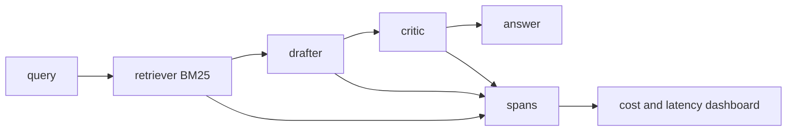

# SAMPLE: RAG, multi-agent orchestration, and trace dashboard

> Illustrative sample on synthetic memos by Kunjar Bhaduri. Every memo is invented. No client, no employer, and no production system. Built by AI coding tools under my direction. October 2026 (America/Chicago).

This library retrieves from a six-memo corpus, runs a retriever, a drafter and a critic, and records OpenTelemetry-style spans. The orchestrate span stores whether that run stayed grounded, the token estimate, the latency and the sample cost. Retrieval hit rate and grounded rate come from `summarize` in `ragobs/evals.py`. A text dashboard rolls those spans up. It does not call a model API, a vector database, or a collector.

## Architecture



The retriever scores token overlap with BM25. The drafter copies up to two sentences with the most overlap. The critic drops a sentence whose content words are not in the retrieved memos. If it drops any sentence, that critique span is status error and a revise span records the drop.

## Run

Python 3.10 or newer. Standard library only. From this repository:

```bash
python3 -m ragobs.demo
python3 -m unittest discover -s tests -v
```

Exit 0 from the demo requires every labeled query to hit the expected memo and to stay grounded. The CI workflow repeats both commands.

## Decisions

- Lexical BM25 instead of an embedding API, so CI runs with no key and no network.
- Extractive answers instead of a generated paragraph, so a test can prove the critic actually drops an uncited sentence.
- A local span list instead of an OpenTelemetry collector. Field names follow the span model (trace_id, span_id, parent_span_id, start and end in unix nano, attributes, status). Nothing is exported.

## Evals

`ragobs/evals.py` holds three labeled queries. `summarize` reports retrieval hit rate, grounded rate, total sample cost and p50 latency. The sample price is 2 dollars per million tokens. That figure is a fixture in `ragobs/agents.py`, not a vendor bill. The dashboard prints ALERT only when the rolled-up estimate reaches 5 dollars.

## Limits

The corpus is six short memos. BM25 on that set is not a production retriever. Token counts are `max(1, len(text) // 4)`. Latency is process time, not a hosted model. There is no failover, no tenancy, and no claim that this ran for a client.
